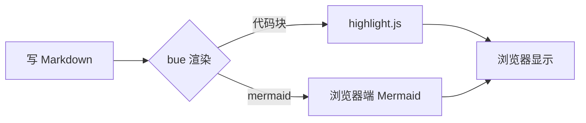
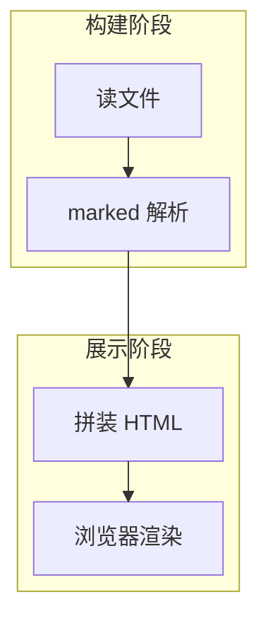
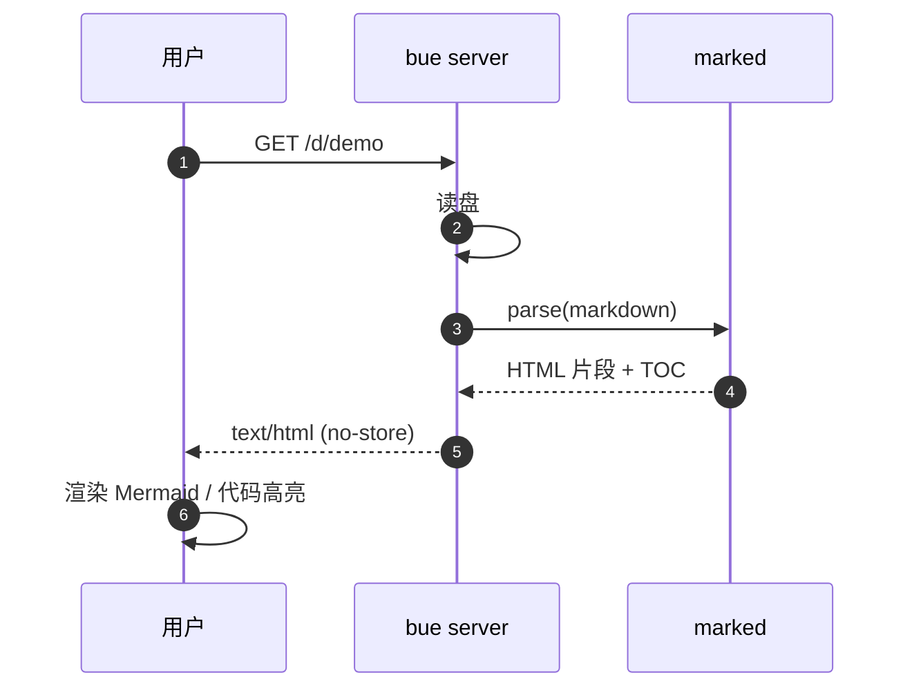
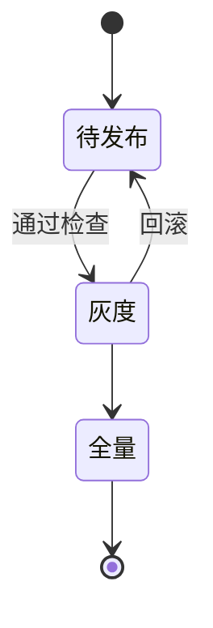
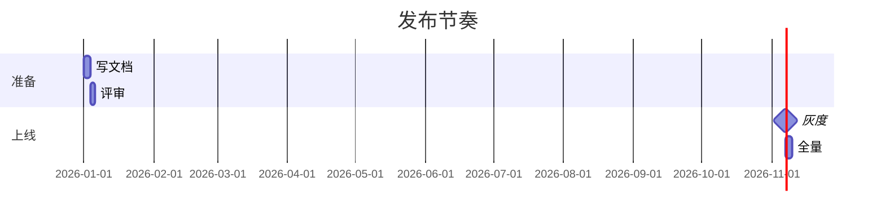
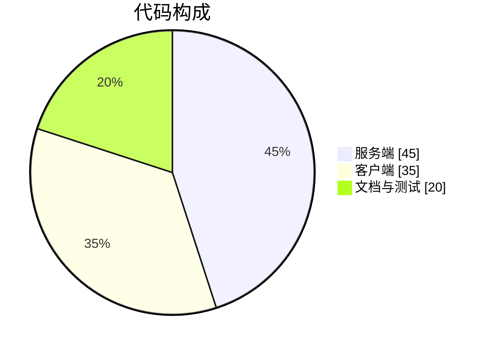

# bue 演示文档

这是一份用来验收 **bue** 的样例，覆盖 Mermaid、代码高亮、表格、引用、任务列表和相对图片。

## 流程图

标准 flowchart 使用 dagre 布局：



同一张图换成 ELK 布局（走 WASM，加载更重）：



## 时序图



## 状态图与甘特图





## 饼图



## 代码高亮

TypeScript：

```ts
export interface RenderSettings {
  theme: "auto" | "light" | "dark";
  width: number;
}

/** 把 markdown 渲染成 HTML 片段。 */
export function render(source: string): string {
  const marked = new Marked({ gfm: true });
  return marked.parse(source) as string;
}
```

Python：

```python
from dataclasses import dataclass

@dataclass
class Doc:
    slug: str
    title: str

    def url(self, port: int = 3000) -> str:
        return f"http://127.0.0.1:{port}/d/{self.slug}"
```

Shell：

```bash
bue README.md              # 预览单个文件
bue docs/                   # 预览整个目录
bue docs/ --no-open         # 不自动开浏览器
bue docs/ --port 4000       # 指定端口
```

## 表格

| 能力 | 说明 | 状态 |
| --- | --- | :---: |
| Markdown 渲染 | marked，GFM 表格 / 任务列表 | ✅ |
| Mermaid | 浏览器端渲染，失败时回落源码 | ✅ |
| 代码高亮 | highlight.js common 语言集 | ✅ |
| 目录 | 右侧折叠面板，滚动高亮 | ✅ |
| 主题 | 跟随系统，可手动切换 | ✅ |
| 热重载 | 无 | ❌ |

任务列表：

- [x] marked 渲染管线
- [x] Mermaid 支持
- [x] 路径穿越防护
- [ ] 自动重载（有意不做）

## 引用与格式

> 预览工具不该因为一个语言标记挂掉整页——所以不认识的语言会降级为纯文本。

行内代码 `renderMarkdown()`、**粗体**、*斜体*、~~删除线~~、`code` 的行内样式，以及 <kbd>Ctrl</kbd> + <kbd>C</kbd> 组合键。

脚注式的可访问写法：首字母 <kbd>A</kbd>，行内 `<code>` 保留尖括号。

## 重复标题（验证锚点去重）

### 安装

### 安装

### 升级

## 文档间跳转

单文件模式下 bue 只装载了 demo.md 一个文件，但同一目录树里的其它文档照样点得开——链接按盘上真实路径解析，不依赖启动时的扫描清单：

- [渲染管线](docs/guide/pipeline.md)：嵌套目录里的文档，它里面的 `[← 返回首页](../README.md)` 顺带验证 `../` 也能解析回根
- [跨文档 + 章节锚点](docs/README.md#相对图片)：跳过去并滚到对应小节
- [进目录](docs)：链到目录，落到该目录的 README（目录里没有 README 就无处可落，保持原样）

`pnpm start examples/demo.md` 后逐条点一遍，任何一条 404 都是回归。

## 数学与符号（不渲染，仅确认不被破坏）

Unicode 覆盖：α β γ δ → ∞ ≈ ≠ ≤ ≥ ± × ÷ ∑ ∏ √ ∫ ∂ ∇

---

至此全部能力已覆盖。